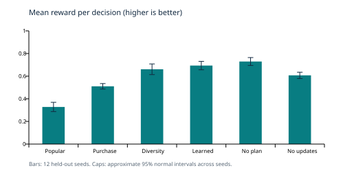
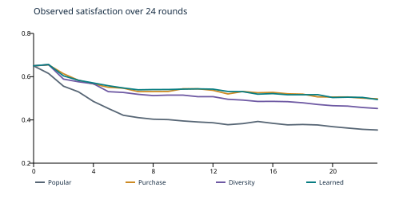

# Dynamic recommendation
with user and merchant agents

Final implementation report | Artificial Intelligence | Group 13 | Prepared 29 October 2026

Delivered scope: Search and Constraint Satisfaction, Recommendation Planning, Reasoning under Uncertainty, and Reinforcement Learning. Generative AI is excluded by the user's direct instruction. All agents and explanations in this implementation are ordinary programmed logic.

## Problem formulation

Target users are shoppers with declared interests, limited budgets and delivery restrictions, plus merchants competing for visibility. Inputs are a product catalog and an evolving interaction history. Outputs are feasible three-item recommendation slates, graph paths, probability estimates, campaign actions and explicit objective trade-offs.

Decision variables are the next campaign action, ranking strategy and distinct items in a slate. Mandatory constraints cover per-item price, availability, delivery, category allow-lists and repeated recommendations. Platform objectives include relevance, category diversity, merchant coverage and sustained satisfaction. A slate contains alternatives; an optional total budget models a cart.

Architecture: planner -> strategy -> graph and beliefs -> CSP -> observed feedback -> updates.

## What was built and measured

The runnable Python project needs no third-party runtime dependencies. A Q-table was trained on 200 episodes with 24,557 recommendation updates and 143 observed state bins. Six variants were evaluated on 12 held-out seeds over 24 rounds. Every evaluated run had zero hard-constraint violations.

All results are measured synthetic experiments. No real shoppers, transactions or behavioral study are represented. Team identities and individual contribution claims were not supplied and are not invented.

# Module 1
Graph search and soft CSP

Retrieve explainable candidates, enforce mandatory requirements, then make platform trade-offs explicit.

## Graph formulation and retrieval

Nodes represent users, items, merchants, categories and reviews. Edges link declared interests, item categories, merchant ownership, related categories and recent interactions. Breadth-first search returns shortest unweighted paths from a user to products within four edges. Paths are saved for every displayed item. The last 100 interactions bound demonstration graph history.

The pool preserves the three highest-scored candidates, category representatives and low-exposure merchant representatives, capped at 12 items. This provides relevant and alternative products without claiming catalog-wide optimality. For small correctness checks the cap can be disabled.

| Type | Rule |
|---|---|
| Hard / unary | Price <= user budget; positive stock; deliverable region; mandatory category allow-list; fewer than two occurrences in the previous eight item impressions. |
| Hard / coupled | Distinct slate members; optional sum of prices <= cart budget; up to three positions. |
| Soft / category | Penalty for max(0, 2 - number of distinct categories). Weight depends on selected strategy. |
| Soft / merchant | Penalty for max(0, 2 - number of distinct merchants). Fair strategy also rewards low prior exposure. |

## Search objective and failure behavior

The objective is sum(item scores) minus weighted category and merchant shortfalls. Backtracking enumerates each candidate combination once. Forward checking prunes combinations that cannot fill the target size or exceed a cart budget. If no full slate is feasible, it searches smaller slates and explains the shortfall. Hard constraints are never relaxed.

Cost is O(V + E) for graph retrieval plus O(n choose k) slate combinations in the capped pool (n <= 12, k <= 3). Scores and category/merchant effects are recomputed after feedback. A budget of one currency unit returns an explicit empty infeasible result. An allow-list containing only books can leave the diversity target unmet.

Validation: independent brute-force enumeration matches unrestricted CSP objective values on ten randomized small cases; tests also cover delivery, stock, mandatory categories, cart limits, repetition and valid BFS paths.

# Module 2
Monitored recommendation planning

Campaigns sequence actions toward a goal; observations decide whether their predicted effects occurred.

A planning state has seven Boolean facts: known preferences, supported existing interest, introduced category, compared alternatives, observed engagement, affordability and readiness after rest. The goal requires all seven. A* searches action sequences with explicit preconditions, positive costs and monotone expected effects.

| Action / cost | Preconditions | Expected new facts |
|---|---|---|
| Ask preference / 0.8 | None | Known |
| Lower-cost alternative / 0.7 | Known | Affordable |
| Wait / 0.6 | None | Rested |
| Familiar / 1.0 | Known, affordable, rested | Supported, engaged |
| Introduce category / 1.2 | Known, supported, affordable, rested | Introduced, engaged |
| Compare / 0.9 | Known, introduced, affordable, rested | Compared |

The admissible heuristic is 0.6 times ceil(number of missing facts / 2): every action costs at least 0.6 and changes at most two goal facts. The initial nominal campaign is ask preference -> familiar -> introduce category -> compare, total cost 3.9. This is optimal in the abstraction, not a guarantee of optimal user outcomes.

## Execution monitoring

An action with no observed engagement does not gain its expected facts. Failed effects clear the remaining plan. Rejection or a negative review clears support/engagement; a budget change requires an affordable alternative; new declared interest requires clarification and renewed introduction. Repetitive low-satisfaction sessions can require rest. Completed campaigns restart while preserving clarified preferences.

The planner controls information/rest turns and adds campaign intent to the learned policy state and item scoring. Clarification uses a structured category response, not language generation. The controller also records the reason, searched sequence and expansion count for each replan.

Validation: tests execute plan preconditions to a goal, verify the nominal cost, reject unobserved effects, and trigger budget, rejection and interest-change replans. Saved demo traces contain the actual plan reasons.

# Module 3
Reasoning under uncertainty

Interpretable, discounted Beta evidence prevents one noisy interaction from defining a user or a merchant.

For each user/category, preference starts at Beta(3,2) for the declared category and Beta(2,2) elsewhere. Purchase propensity starts at Beta(1.5,5.5). Merchant fulfillment starts at Beta(3,2); reviewer and claim credibility start at Beta(2,2). Means and standard deviations inform ranking and exploration.

For fractional outcome y and evidence weight w: alpha <- alpha + w*y; beta <- beta + w*(1-y). Each round discounts evidence above the prior by 0.97. This is a generalized Bayesian evidence model: the hand-set weights are not a fully fitted likelihood or a calibrated posterior over real behavior.

| Observation | Preference evidence |
|---|---|
| Click / browse | Small positive evidence: click y=0.7, w=0.35; browse y=0.55, w=0.1. |
| Like / ordinary purchase | Like y=0.9, w=0.8; purchase y=0.9, w=1.0. |
| Gift purchase or review | Preference evidence is multiplied by 0.15. Purchase itself still counts as purchase evidence. |
| Ignore / explicit reject | Ambiguous ignore y=0.4, w=0.08; observably unattended ignore has zero preference weight; reject y=0.05, w=0.9. |
| Review | Normalized rating with verification/reviewer weighting. Unverified review weight is 15% of verified weight. |

## Predictions and reliability

Predicted purchase probability combines posterior purchase propensity, preference, merchant reliability and affordability, clipped to [0.01,0.95]. A preference mean minus one standard deviation supplies a risk penalty. Merchant quality claims are shrunk toward 0.5 according to separate claim credibility; merchant-written text cannot create its own trust.

Fulfillment observations update merchant reliability. Independently corroborated review outcomes can update reviewer and claim credibility. Verification, gift and attention annotations are strong synthetic-data assumptions, not an implemented real-world fraud detector. Reported 95% preference intervals use a clipped normal approximation and are labeled approximate.

Validation covers analytical updates/decay, weak click evidence, discounted gifts, ambiguous silence, verification weighting and resistance to self-reinforcing merchant claims.

# Module 4
Sequential Q-learning

The learner selects how to rank feasible recommendations; the planner and CSP retain their own roles.

| Element | Implementation |
|---|---|
| Observed state | Highest-mean category, uncertainty bin, satisfaction bin, budget bin, recent category repetition, merchant-exposure imbalance, item-popularity concentration and campaign intent. |
| Actions | Popular, personalized, diverse, fair and exploratory ranking strategies. Search/CSP determine the final products. |
| Learning | Tabular off-policy Q-learning; alpha=0.12, gamma=0.90. Epsilon falls linearly from 0.75 to a floor of 0.08. |
| Training | 200 independently seeded synthetic episodes, up to 24 rounds and six users; seeds 500000-500199; agent seed 7. |
| Evaluation | Frozen Q-values; held-out seeds 100-111; demo seed 42. Unseen state bins fall back to personalized ranking. |

## Reward and temporal credit

Recommendation reward = 0.25*click count + purchase count + 0.35*satisfaction + 0.15*slate category ratio + 0.15*low-exposure share - 0.30*repeated-item share - 0.25*(1-average utility) + 0.05*continued engagement. Dropout incurs 0.8 additional cost. Clarification costs 0.04 and rest costs 0.03; empty slates cost 0.2.

Q(s,a) <- Q(s,a) + alpha * [G + gamma^elapsed * max Q(next_state) - Q(s,a)]. G includes discounted intervening clarification/rest costs between consecutive recommendation decisions for the same user. Terminal dropout and episode ends have no bootstrap. Visit counts and episode returns are saved with the policy.

The policy never receives hidden preference or quality vectors. The simulator emits a public satisfaction proxy and gift/attention/fulfillment annotations; reward also uses simulated utility. In practice these feedback signals would need estimation. The changing, partially observed environment and coarse state bins prevent a convergence or optimality claim.

Measured training artifact: 143 state bins and 24,557 Q updates. Evaluation reports how often a recommendation state was present in training. The included Q-table permits immediate demonstration without retraining.

# Experiments
Frozen, held-out comparisons

Six variants, 12 independent environment seeds each, 24 rounds per run, up to six active users. All values below are measured means.

| Variant | Reward / turn | Click rate | Buy rate | Satisfaction | Retention |
|---|---|---|---|---|---|
| popular | 0.3279 | 0.2857 | 0.0920 | 0.3534 | 0.7917 |
| personalized | 0.5103 | 0.3576 | 0.1172 | 0.4977 | 0.9583 |
| fixed_diversity | 0.6608 | 0.3579 | 0.1103 | 0.4529 | 0.9861 |
| learned | 0.6935 | 0.3696 | 0.1158 | 0.4943 | 1.0000 |
| no_planning | 0.7293 | 0.3793 | 0.1122 | 0.4949 | 0.9583 |
| no_belief_updates | 0.6071 | 0.3330 | 0.1064 | 0.4317 | 0.9861 |

| Variant | Slate diversity | Merchant Jain | Item HHI | Buy Brier |
|---|---|---|---|---|
| popular | 0.7707 | 0.1909 | 0.1482 | 0.0865 |
| personalized | 0.5176 | 0.5688 | 0.0590 | 0.1117 |
| fixed_diversity | 0.6659 | 0.5827 | 0.0487 | 0.1039 |
| learned | 0.6029 | 0.7517 | 0.0382 | 0.1087 |
| no_planning | 0.6093 | 0.6358 | 0.0433 | 0.1072 |
| no_belief_updates | 0.6322 | 0.7861 | 0.0483 | 0.1012 |

Popular ranks by popularity alone; personalized ranks by estimated purchase probability alone; fixed_diversity adds a fixed novelty/coverage rule. They share the same planner and hard constraints. Learned Q-learning varies strategy and uses campaign scoring. No-planning and no-belief-updates are ablations of the frozen learned policy, so distribution shift is part of their observed effect.

## Metrics and uncertainty

Click/purchase rates divide by item impressions. Reward per turn divides by active-user decisions, including information turns. Slate diversity is distinct categories / slate size. Jain equality measures unweighted merchant exposure (1 means equal); HHI measures item exposure concentration (lower is more distributed). Brier is mean squared purchase-probability error (lower is better). Final satisfaction includes inactive users; retention is the final active fraction.

Raw results also include cumulative reward, category entropy, novelty, repetition, learned-state coverage and all merchant exposures. Approximate 95% intervals use mean +/- 1.96*standard error across independent seed-level results. Paired intervals use within-seed differences. These are exploratory small-sample normal approximations, without multiplicity correction.

Training and test seeds are disjoint. Keyed randomness shares exogenous noise for matching user/item/round events; histories, rank and inventory still change with policy. No hyperparameter search or real-user validation was performed. All 72 evaluation runs reported zero hard-constraint violations.

# Results
Gains, trade-offs and negative findings

The learned model performs well on several objectives in this simulator, while planning and diversification expose measurable costs.

Learned reward/turn was 0.6935, compared with 0.3279 for popular and 0.5103 for purchase-only ranking. Its difference from fixed diversity was 0.0327, with an approximate paired interval [0.0025, 0.0630]; that interval excludes zero. This is exploratory evidence under the stated simulator.

Learned merchant Jain equality was 0.7517 and retention was 1.0000. The diverse baseline had greater within-slate category diversity (0.6659 vs 0.6029). Purchase-only ranking also had a higher purchase rate. Thus no single variant dominates every objective.

Removing planning increased reward/turn to 0.7293. Final satisfaction was 0.4943 with planning and 0.4949 without it; the paired difference interval was [-0.0160, 0.0149]. Questions and rest consume turns in this short horizon. The planner's action model needs better empirical grounding; these results do not establish a planning benefit.

The no-belief-updates variant had lower reward and satisfaction than the integrated model. This supports the usefulness of adaptation in this designed scenario, but is not an isolated causal estimate because the frozen policy also encounters different states. Purchase Brier scores across policies reflect different exposure/outcome distributions and are not directly controlled calibration comparisons.

# Dynamics and limitations
What the evaluation establishes

Multi-round simulation reveals feedback loops that a one-shot ranking example cannot show.

The shared scenario changes popular-merchant prices at round 4, injects a negative verified review at 6, reduces one budget at 8, introduces a new merchant and four products at 10, changes two declared interests at 12, removes one merchant's stock at 16, and increases incumbent popularity at 18. Merchant agents respond to low reviews every third round with a discount and description update. Round numbers start at zero.

As users click, like, ignore, reject, purchase and review, popularity and availability evolve. Repetition reduces hidden affinity and utility; low satisfaction can cause dropout. The report therefore measures both immediate interaction rates and longer-term satisfaction/retention. This is an explicit set of simulator equations, not a claim about real human psychology.

Key limits: a small hand-built catalog; fixed agent rules; no real data; synthetic observation labels; approximate probability models; bounded-pool search; a small symbolic campaign abstraction; coarse RL state; one reward design; only 12 test seeds and 24 rounds. Equal merchant exposure ignores relevance, delivery eligibility, catalog size and arrival time. Group-level fairness and demographic fairness are not evaluated.

Future work within Modules 1-4 would validate behavior using suitable data, evaluate many horizons and reward weights, normalize exposure by opportunity/relevance, fit calibrated observation models, and learn or revise action models. The Generative AI component remains outside the delivered scope.

# Delivery and provenance
Reproduce, inspect and explain

The software is ready for immediate review. Administrative identity and contribution claims must be supplied truthfully by the actual team.

| Deliverable | Location / verification |
|---|---|
| Working code and fixture | recsys/, data/catalog.json; Python >=3.10; no third-party runtime dependency. |
| Immediate demo | python3 -m recsys demo; included trained policy; full trace and compact excerpt in results/. |
| Correctness checks | python3 -m unittest discover -s tests -v; 24 tests passed in the delivered implementation. |
| Full reproduction | python3 run_all.py; tests, training, held-out evaluation and demonstration. |
| Measured evidence | results/evaluation.json, metrics.csv, round_metrics.json, policy.json and VALIDATION.json. |
| Review support | README.md; docs/REQUIREMENTS.md; docs/EVALUATION_GUIDE.md; docs/CONTRIBUTIONS.md. |

## Research-inspired extension

RecInter [1] motivates interactions that update products and elicit merchant responses. Proactive recommendation [2] motivates multi-step campaigns revised after feedback. Unpaired-feedback work [3] motivates using continued engagement and treating silent sessions cautiously. The extension combines these ideas with hard feasibility, explicit coverage trade-offs and uncertain preference evidence in a transparent non-generative system.

This is not a reproduction of the papers: it uses programmed agents, A*, discounted Beta evidence and Q-learning rather than their LLM systems, actor-critic/KTO training or datasets. No paper code, checkpoints or performance results were copied. The implementation and synthetic fixture were created with Codex assistance; team understanding and independent review are necessary for the viva.

## Primary references

[1] Jin et al. (2025). Beyond Static Testbeds: An Interaction-Centric Agent Simulation Platform for Dynamic Recommender Systems. EMNLP, 18903-18920. https://aclanthology.org/2025.emnlp-main.956/

[2] Wang et al. (2025). Tunable LLM-based Proactive Recommendation Agent. ACL, 19262-19276. https://aclanthology.org/2025.acl-long.944/

[3] Zhang et al. (2025). Leveraging Unpaired Feedback for Long-Term LLM-based Recommendation Tuning. Findings of EMNLP, 24507-24521. https://aclanthology.org/2025.findings-emnlp.1332/

Project requirements: supplied AI project Guidelines.pdf and Group 13 - Recommendation.pdf. The user's request excludes Generative AI for this delivery. The verified primary RecInter page range differs from the range printed in the supplied group brief. Evaluation date, member names and prior human contributions were not provided.

